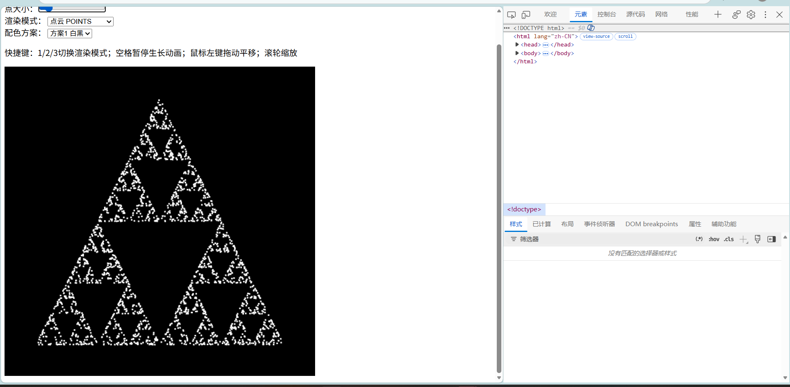
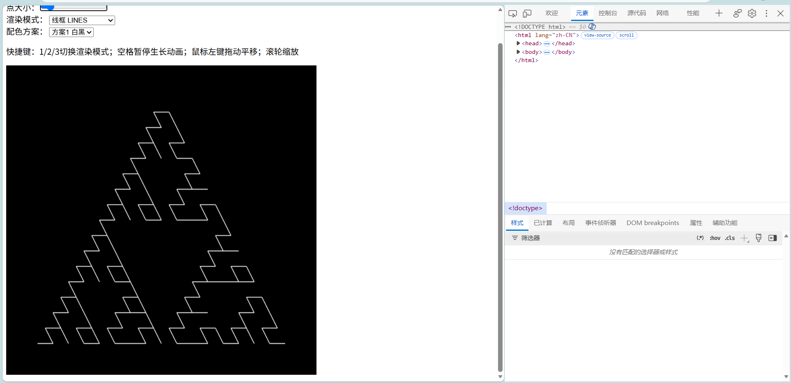
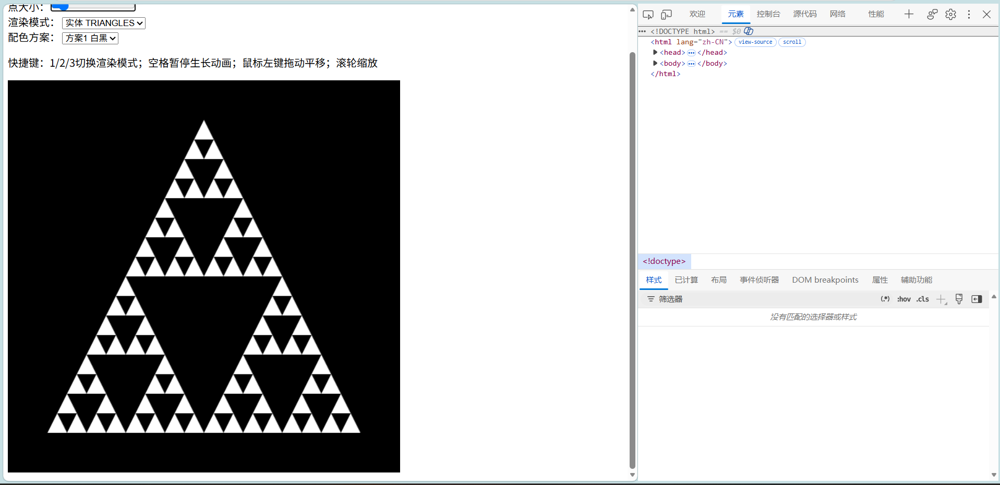

# AP1 交互式2D分形 Sierpinski垫片
## 运行方式
本项目使用WebGL2.0实现，必须通过静态HTTP服务器打开，**不支持直接双击html以file协议打开**。
本地使用VSCode Live Server插件，右键index.html → Open with Live Server运行。

在线访问URL：【后续把你的公网链接粘贴在这里】

## 实现要点
### 混沌游戏算法
给定三角形的3个顶点，初始化一个随机起始点；每一轮随机选取三角形其中一个顶点，执行更新公式 `p = (p + 随机顶点)/2`，迭代生成大量点；使用`gl.POINTS`渲染点云，实现点逐步生长动画。

### 递归细分算法
`subdivide(triangle, depth)`递归函数：把输入三角形取三边中点，分割成3个小三角形；递归直到达到设定最大深度，输出全部小三角形顶点。
支持三种渲染图元：点云`gl.POINTS`、线框`gl.LINES`、实体填充`gl.TRIANGLES`。

## 交互操作说明
1. UI面板
- 递归深度：控制递归细分的迭代层数（范围0‑6）
- 点数量：混沌游戏生成的总点数
- 点大小：控制点云模式下点的像素大小
- 渲染模式下拉：切换点云、线框、实体三种绘制模式
- 配色方案：3套颜色切换

2. 鼠标
- 鼠标左键按住拖动：平移整个图形
- 鼠标滚轮：缩放图形

3. 键盘快捷键
- `1`：切换到点云POINTS模式
- `2`：切换到线框LINES模式
- `3`：切换到实体TRIANGLES模式
- `空格`：暂停 / 继续点云生长动画

## 效果截图

### 点云模式

### 线框模式

### 实体模式

## 代码组织结构